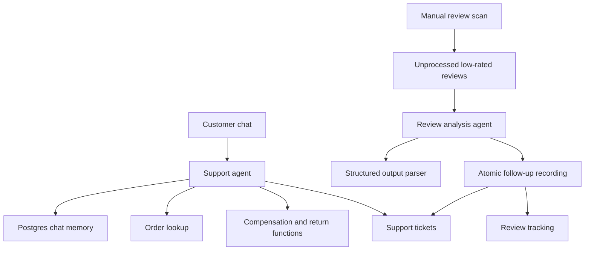

# Olist Customer Support Automation

An n8n and PostgreSQL demo that connects conversational support with proactive review triage.

**Built by Tzuf Horovitz | n8n · Supabase/PostgreSQL · OpenAI**

The project uses an Olist dataset containing 99,441 orders. It demonstrates two workflows: customers can ask about orders and request policy-based actions; a separate manual batch identifies low-rated reviews and prepares support tickets.

## Two workflows, one database

| Workflow | Input | Outcome |
| --- | --- | --- |
| Customer support | Chat message and order ID | Order details, simulated delay compensation, return approval, or a support ticket |
| Review follow-up | Up to 10 unprocessed reviews rated 1 or 2 | English analysis, issue category, and a linked support ticket |

The model interprets messages and writes responses. Parameterized SQL and database functions validate actions, calculate compensation, and store results. The review pipeline preserves identifiers from SQL rather than trusting the model to reproduce them.

## Architecture

The parser constrains the review agent's output; it is an attached sub-node in n8n. Both agents share an OpenAI model configuration, but only the chat agent has conversation memory.

### n8n Workflow Canvas

*Top branch: Reactive customer support agent connected to PostgreSQL chat memory and four parameterized SQL tools (`Execute a SQL query in Postgres`, `execute_delay_compensation`, `request_standard_return`, and `create_support_ticket`). Bottom branch: Proactive batch pipeline (`bad_reviews` → `Review Follow-up Agent` with `Structured Output Parser` → `Save Review Follow-up`).*

## What it demonstrates

- Order lookup across items, products, payments, reviews, and existing compensation requests.
- PostgreSQL chat memory with a 20-interaction context-window setting.
- SQL-calculated delay compensation, with fixed-value vouchers based on the current order total.
- Per-item standard return requests recorded as `awaiting_return`; approval does not issue a refund.
- Manual escalation for damaged items, wrong items, and disputes.
- Structured review classification and English summaries of Portuguese feedback.
- Database-backed duplicate prevention and review-to-ticket traceability.

## Demo policy

The reference date is fixed at **2018-10-18** to work with historical data. Business days mean Monday–Friday, without holiday calendars.

| Delivery delay | Available simulated benefit |
| --- | --- |
| 1–3 business days | Fixed voucher worth 10% of the current order total |
| 4–7 | 15% refund OR fixed voucher worth 20% |
| 8–14 | 30% refund |
| 15+ | Full refund OR free replacement, including eventual delivery |

Standard returns require delivery within 30 calendar days, unused condition, original packaging, and tags, subject to exclusions. Expected refunds exclude shipping and account for prior compensation. See the limitations below before relying on this calculation.

## Visual Walkthrough

### 1. Standard Return with Automatic Prior-Compensation Deduction
When a customer requests a standard return (`buyer_remorse`) for order `ae213a9f84c777fb7a31e8c0f09fd30c`, the agent first verifies all condition requirements (unused, original packaging, tags attached, and non-excluded category) before invoking `request_standard_return`.

* **Database-enforced calculation:** PostgreSQL verifies that the order is within the 30-day window (`days_since_delivery: 29`), takes the item price only (`item_price: 364`), excludes shipping (`shipping_not_refunded: 34.69`), and automatically deducts prior delay compensation already granted on the order (`prior_compensation_deducted: 50`) to compute `expected_refund_amount: 314`.
* **Warehouse-gated workflow:** The request is saved as `awaiting_return` with return code `RET-AE213A-1` (`refund_issued_now: false`), and the agent informs the customer of the 5–7 business day post-inspection refund SLA.

---

### 2. Database Fact-Checking & Support Ticket Escalation
When a customer claims that order `e481f51cbdc54678b7cc49136f2d6af7` arrived two weeks late and that the item inside was cracked, the agent checks the order record first and then escalates the physical-damage report via `create_support_ticket`.

* **Fact-checking against SQL records:** The agent identifies that the order was delivered on `2017-10-10` against an estimated delivery date of `2017-10-18` (8 days early, `delay_business_days = 0`) and is outside the 30-day return window, clearly explaining why automatic delay compensation does not apply.
* **Structured escalation:** Because the customer reported a cracked item, the agent calls `create_support_ticket` with `reason: damaged_item`, faithfully summarizing the customer's unverified claim and returning `ticket_id: 24`.

---

### 3. Proactive Review Triage (Portuguese to Structured English)
The manual batch workflow queries unprocessed 1- and 2-star reviews (`bad_reviews`) alongside order timestamps and status, passing each record to the `Review Follow-up Agent` constrained by a JSON `Structured Output Parser`.

* **Structured classification:** Each review is mapped to a strict `issue_category` (`product_quality`, `unknown`, `wrong_item`, etc.) and a concise `<150 word` English report.
* **Discrepancy detection:** The agent separates customer claims from database facts—for example, highlighting when a customer reports receiving the wrong item on an order whose database status is `canceled` with no recorded delivery date, or recommending outreach without photo requests when a 1-star review contains no text.

---

### 4. Atomic Follow-Up Recording & Ticket Linking
After the `Review Follow-up Agent` generates the structured analysis, the `Save Review Follow-up` node executes `public.record_review_followup` in PostgreSQL.

* **Idempotent persistence:** Each processed review is recorded in `review_followups` and linked to a support ticket (`ticket_id: 25` through `32`), preserving `order_id` and `review_id` directly from the SQL query input rather than relying on the LLM to copy identifiers. Subsequent batch runs automatically skip already-processed reviews.

## Files

- `workflows/olist-support.json`: sanitized n8n import, with credentials removed.
- `sql/01_schema.sql`: 12 empty tables, constraints, indexes, and RLS.
- `sql/02_functions.sql`: three exported business functions.
- `sql/03_access.sql`: explicit Supabase public-role restrictions for the demo.
- `docs/setup.md`: installation and data import.
- `docs/validation.md`: observed tests and untested cases.
- `docs/limitations.md`: known limitations and production gaps.

## Quick start

Use a **new disposable Supabase project**, run SQL scripts in numeric order, import the eight source CSVs, import the n8n workflow, and configure your own PostgreSQL and OpenAI credentials. Follow [setup instructions](docs/setup.md).

**Do not run the setup scripts on the original working database.** They create fresh objects, not migrations.

## Validation and scope

Manual demonstrations covered order lookup, selected compensation/return scenarios, repeated-request handling, and two review batches (20 reviews). No accuracy benchmark, load test, or measured business savings is claimed.

This is a portfolio prototype: no real money transfers, warehouse integration, replacement fulfillment, or outbound customer contact occurs. Order ID lookup is not customer authentication. Review analyses are drafts for human review.

The export preserves current behavior, including documented [known limitations](docs/limitations.md). Generated SQL has been structurally checked but has not yet been executed against a fresh PostgreSQL instance.

## Data and credits

Uses the Brazilian E-Commerce Public Dataset by Olist. Obtain the original dataset separately and comply with its source license. Source CSV data and chat histories are not included in this repository.

Built with AI-assisted development; workflow design, policy decisions, integration, and manual scenario validation are part of this project.